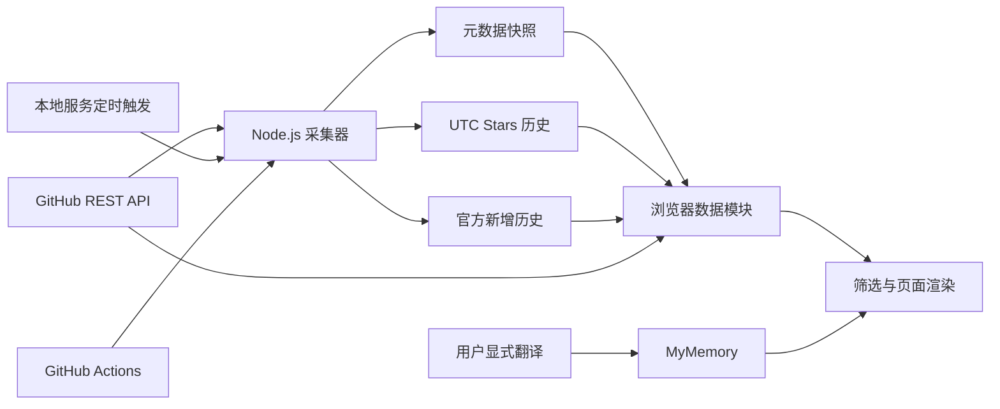

# GitHub Pulse 技术设计

GitHub Pulse 采用浏览器原生 ES Modules、静态 JSON 与 Node.js 采集脚本构成的轻量架构。浏览器负责筛选、计算和展示；持久化采集由命令行、本地服务或 GitHub Actions 执行。当前没有业务 API 服务、数据库或用户账号系统。

设计以可追溯采样和失败保留为基础：元数据、官方新增历史和本地净增历史分别保存，派生指标计算时校验时间、完整性与可用状态。对应功能编号见[需求说明](requirements.md)。

下一节说明已实现的三组新建工程增星榜和近三年总星榜；其余章节记录底层架构、数据计算、采集与运行行为。

## 新看板设计

### 近期飙升榜

以配置数组 `[{ days: 7, field: 'weekAdded', limit: 30 }, { days: 30, field: 'monthAdded', limit: 30 }]` 驱动两张飙升榜。与新建工程榜的唯一差别是不设创建时间窗口：全部可用工程按同一窗口终点的官方新增 Stars 排名，创建已久但近期爆发的工程由此进入主视野。`selectSurgeProjects(snapshot, { field, limit, category, query, windowEnd })` 复用共同日界 `growthWindowEnd`，日界不一致或历史缺失的工程计入待补。

加速度由 `summarizeStarActivity` 额外汇总的上一个完整周（`prevWeekAdded`）计算：本周新增 ≥ 上周 3 倍且本周 ≥ 20 颗标记 `accelerating`；上周为零且本周达标视为新爆发，`accelerationRatio` 保持 `null` 而非无穷大；上周历史缺失两者皆为未知。页面在仓库行展示 🚀 标记与倍数。

### 新增工程增星榜

以配置数组统一驱动三组排行：`[{ days: 3, limit: 10 }, { days: 7, limit: 10 }, { days: 30, limit: 30 }]`。用 GitHub `createdAt` 判定新建，而不是注册时间或首次采集时间。先确定共同的完整统计日窗口，再筛选该窗口内创建的仓库，最后按对应窗口的新增 Stars 排序。

每张榜使用一致的窗口终点 B，创建资格为 `B − days × DAY <= createdAt < B`。增长取同一窗口完整日计数之和；缺少历史时为 `null`，不能用总 Stars 或本地净增代替。具有核验创建时刻且完整结束于创建前的统计日仍可确定为零。窗口起止时间、覆盖数和待补数随榜单返回，供页面披露。不同日界的记录不混排。

`summarizeStarActivity` 增加 `threeDayAdded`，保留 `weekAdded` 和 `monthAdded`；`assembleSnapshot` 返回三个新建工程榜及各自覆盖状态。统一由 `selectNewProjectGrowth(snapshot, { days, limit, category, query, windowEnd })` 处理公开性、创建窗口、搜索、领域、历史完整性及排序，避免页面与数据层维护两套资格规则。

默认窗口终点由当前有效历史确定；记录终点不匹配的仓库单列待补，不能悄悄将其算进覆盖分母之外。各榜按新增 Stars 降序、总 Stars 降序、仓库全名字典序排序。数据足够时分别取 10、10、30 项，不足时按实际数量展示。同一工程允许在不同周期重复入榜。

`app.js` 与 `index.html` 将旧周月全量榜及近期新建总星榜合并为三个新建工程增星区域。仓库行展示创建日期、窗口新增、总 Stars 与采样时间。辅助本地净增分析保留独立入口，主榜固定官方新增口径。

### 近三年总星榜

收录范围限定为创建时间在滚动三年窗口内（`SCOPE_YEARS = 3`，窗口起点为当前 UTC 日期减三年）。以当前 UTC 年 Y 生成 `[Y, Y−1, Y−2, Y−3]` 四组（最旧一年只含窗口内月份），对每组独立调用创建年份筛选与 `stars` 降序排序，限制 30 项。2026 年 10 月对应 2026 至 2023 年，跨年重算年份数组。当前年显示截至最近采样的数据，往年仍按当前累计 Stars 排名。

年度数据结构为 `yearlyTop30: [{ year, projects, coverage }]`。每年默认全领域 Top30，领域或搜索变化后从全部该年匹配工程重新排名，而不是过滤已截断的 30 项。未知创建时间或总 Stars 不入榜。页面按年份倒序呈现四组，当前年默认展开；不再遍历全部历史年份或默认按每个领域取 Top10。

### 候选采集调整

近 3 天必须有独立发现查询，不能只从 7 天总星前 100 项中再截取，否则可能遗漏三日新建候选。近期发现使用独立的 3、7、30 天查询，额外覆盖一天以容纳日界差异，并补充滚动三年窗口内的年度创建区间查询（起点年为窗口起点日期起算）。年度查询上下界必须限定到对应年份，当前年不得接受未来创建时间。

除创建窗口外另有三个"活跃飙升"发现通道：按星数分层（50–500、500–5000、5000+）查询最近一周有推送的公开仓库，仍按总 Stars 排序取前 100。创建已久、上周才爆发的工程不必等总星数进入年度前 100 才会被发现。发现阶段结束后，剩余请求预算在同一轮内对新候选试探官方历史，确认增长的工程当轮即具备入榜资格。

浏览器单次四组查询：三个近期窗口加一个年度，成功批次后推进年度游标，四轮覆盖四个年度；分层活跃通道只由持久化采集执行，不占浏览器限额。CLI 执行十组发现，按查询最近完成时刻优先继续未完成组，并遵守总请求、分页及响应头限额。查询覆盖记录包含 ID、年份或天数、分页、截断及完成时刻；无最低星数门槛。

Search 按总 Stars 返回的是发现候选，不是增星排序结果；候选取得官方历史后才参加增星榜。搜索分页造成的截断必须披露，近期和年度发现不设最低 Stars 门槛。不得把样本榜宣称为全站 Top。

### 实现与验收范围

1. 扩展三日官方历史汇总与三个创建窗口的统一筛选，验证缺测、创建前零值、窗口边界及共同日界。
2. 增加三年滚动窗口的年度分组和每年 Top30，验证跨年、领域筛选及累计 Stars 排序。
3. 调整近期与年度发现队列，验证独立三日查询、年度边界、分页、预算和续跑。
4. 更新页面三组增星榜、年度四组总星榜及口径说明，同步根目录运行说明与帮助页；完成真实浏览器验收。

测试覆盖“旧工程本期增星更高仍不入新建榜”“三榜条数为 10、10、30”“新建时间与增长窗口一致”“每年 Top30 独立排序”“跨年自动滚动四组”“超龄工程随滚动窗口自动裁剪”等场景。页面同步显示窗口和待补数量，实际接口权限与远端部署链路需在对应环境验收。

## 系统结构



浏览器取得的元数据只合并到当前页面内存，官方历史另外缓存于浏览器 `localStorage`；这些结果不会自动写回工程 JSON 或 Git。静态部署需要另行发布采集器提交的数据。MyMemory 仅在用户点击翻译后接收描述文本。

### 模块分工

| 模块 | 主要职责 | 对应需求 |
| --- | --- | --- |
| `index.html`、`styles.css` | 页面结构、主题、响应式布局与可访问标签 | FR01 至 FR14 |
| `app.js` | 页面状态、数据刷新、样本合并、筛选、榜单、交互及错误说明 | FR01 至 FR14、FR16 |
| `src/data/github-data.js` | API 字段映射、数据标准化、分类、评分、聚合、搜索采样和翻译 | FR02、FR03、FR07 至 FR13 |
| `src/data/history.js` | 精确 UTC 日期基线的净增与逐日趋势 | FR05、FR06 |
| `src/data/star-activity.js` | 官方历史校验、统计窗口、缓存合并、分批刷新与限额回退 | FR05、FR06、FR15 |
| `scripts/sync-github-data.mjs` | 历史优先采集、元数据更新、新项目发现、续跑和文件发布 | FR15 |
| `scripts/serve.mjs` | 本地静态文件白名单服务与后台采集触发 | FR01、FR15、NFR03 |
| `start-dashboard.cmd`、`scripts/start-dashboard.ps1` | Windows 后台启动、服务复用与浏览器打开 | FR15 |
| `.github/workflows/sync-data.yml` | 定时采集、artifact 保存及数据提交 | FR15 |
| `help.html` | 数据范围与使用说明 | FR16 |

## 数据模型

### 元数据快照

`github-snapshot.json` 保存仓库注册集合和采集状态。核心结构为 `schemaVersion`、`source`、`fetchedAt`、`projects`、`coverage`、`sync`、`rateLimits`、`warning` 和 `warnings`。浏览器加载后用 `assembleSnapshot` 生成派生字段与展示统计，不依赖旧文件内的增长值。

| 仓库字段 | 类型与含义 |
| --- | --- |
| `id`、`fullName` | `owner/repo` 格式字符串；浏览器与采集器用小写全名作为去重键 |
| `githubId` | 持久化采集记录的 GitHub 数值 ID，未取得时可为空 |
| `name`、`description`、`topics`、`language` | 原始描述和分类输入；topics 为字符串数组，语言可为空 |
| `stars`、`forks`、`openIssues`、`contributors` | 非负安全整数或 `null`；当前接口不提供贡献者计数 |
| `license` | SPDX 字符串或 `null`；`NOASSERTION` 等标识按未知处理 |
| `createdAt`、`pushedAt`、`updatedAt` | 可解析的 GitHub 时间字符串或 `null`，各自保留语义 |
| `fetchedAt`、`sampleDate` | 最近成功采样时刻及 UTC 日期；精确采样时刻是有效观察记录的必要条件 |
| `availability` | `available`、`unavailable` 或 `unverified` |
| `lastAttemptAt`、`nextRetryAt`、`lastError` | 最近尝试、下次可重试时刻和错误；失败不覆盖成功采样时刻 |
| `source`、`metadataSource`、`provenance` | 来源标识，供追溯使用 |
| `archived`、`disabled` | 采集器保留的状态；当前不作为所有榜单的统一排除条件 |

派生字段包括 `category`、`categoryTags`、`categoryVersion`、`categorySource`、`licenseRisk`、`todayStars`、`weekStars`、`monthStars`、`weekAdded`、`monthAdded`、`addedDays`、`activityWindowEnd`、`activityFetchedAt`、`opportunityScore` 等。展示层必须保留 `null` 与真实 `0` 的区别。

### 本地 Stars 历史

`star-history.json` 按仓库全名和 UTC 日期保存当日最后成功的 Stars 样本：

```json
{
  "example/project": {
    "2026-10-03": 100,
    "2026-10-10": 110
  }
}
```

以上为结构示例，不代表真实仓库数据。同日仅更新当日值，前日记录不被覆盖。`recordDailySample` 清理过期和无效记录，保留约 45 天窗口。日期键没有精确采样时刻，因而只能支持每日采样差，不能重建精确的小时窗口。

`legacy-history.json` 保存缺乏完整采集证据的旧历史，不参与当前计算，也不在本地静态服务白名单内。

### 官方新增历史

`star-activity.json` 和浏览器缓存使用相同结构：

```text
schemaVersion: 1
repositories:
  owner/repo:
    source: github-star-history
    fetchedAt: ISO 时间
    weeks: [{ week: Unix 秒, total: 整数, days: 七个整数 }]
status:
  attemptedAt, updated, requests, failures, authenticated, retryAfter, message
```

校验要求包括非空周数组、合法周时间戳、每周恰有七个非负整数、日计数之和等于周总量、周时间戳不重复且不重叠。缓存合并优先保留较新成功记录。原始周数据用于重新计算当前窗口，不只保存汇总结果。

## 核心计算设计

### 分类与可用性

标准化过程检查仓库全名、计数和时间格式。没有可追溯 `fetchedAt` 的旧记录进入 `unverified`；显式不可用记录保持 `unavailable`；可用且具备成功采样时刻的记录进入 `available`。

分类使用 `CATEGORY_VERSION = 2` 的加权规则：topics、描述、名称/全名、语言分别按 5/3/2/1 计分，同一来源多个命中可小幅加分；最高分成为主分类，达到阈值的其余高分领域成为最多三个次标签。语言单独命中低于主分类阈值，因此 Swift/Kotlin 不再直接把桌面或服务端工程归入移动开发。当前领域包括 AI、开发者工具、Web、基础设施、数据、移动、安全、效率、创意设计和知识学习。

快照保存当前规则的 `category`、`categoryTags` 与 `categoryVersion`。标准化时只信任版本一致的自动分类；旧版本或缺失版本会按当前规则重算。`categoryOverride` 是人工覆盖入口，优先于规则结果，次标签仍保留规则推断，便于筛选稳定与语义追溯并存。

### 官方统计窗口与本地净增

官方窗口以最新接口周时间戳为锚点，按 24 小时间隔求出当前统计日的起点，以该起点作为最近完整日窗口的结束时刻。只有采样已覆盖该结束时刻、周记录有效且所需日期完整时才汇总。未来采样、过期周锚点和跨日陈旧缓存返回未知。

本地净增公式为 `当前 Stars − 精确 N 个 UTC 日期前的 Stars`，N 为 1、7、30。只有当前端点属于当前 UTC 日且没有未来时间，才启用净增计算；不存在精确基线时返回 `null`。本地趋势直接比较历史文件中的相邻 UTC 日期值。

官方趋势选择一周完整历史中最新的窗口结束时刻，只合并与之相同的工程。本地趋势对每个日期分别累计有效仓库的差值，并输出该点覆盖数。

### 排序与页面状态

页面状态包括领域、关键词、目录条数、飙升榜与新建榜的周期 Tab、活动展开状态、辅助分析口径、年度折叠状态、年度发现游标、加载标记和错误；创建年份由当前 UTC 年自动生成。`projects()` 从可用仓库中筛选，`renderRankings()` 再计算 Top N，避免先截断全局榜单后漏掉分类项目。

领域分布图使用全部可用样本，其余关键指标、活动、趋势和榜单使用当前筛选集合。研究评分增速项始终读取官方 `weekAdded`，不随辅助分析口径切换。

### 研究评分

`scoreOpportunity` 是代码定义的启发式参考分，要求 Stars、Forks、官方一周新增（`weekAdded`）、有效最近推送时间和可识别许可证。缺少任一输入或推送时间在未来时返回 `null`。

令 `S = max(1, stars)`，`F = max(1, forks)`，`D` 为距最近推送的天数，评分为下列因素求和后四舍五入：

| 因素 | 实现公式 | 最高分 |
| --- | --- | ---: |
| 增速 | `clamp(weekAdded / S × 570, 0, 40)` | 40 |
| Fork 比例 | `max(0, 15 − abs(log2((S / F) / 8)) × 7.5)` | 15 |
| 采用度 | `min(25, log10(S) × 5)` | 25 |
| 活跃度 | `max(0, 10 − D)` | 10 |
| 许可证规则 | 实现中的 permissive 为 10、copyleft 为 6、risky 为 2，unknown 不评分 | 10 |

这些许可证类别是实现中的标识规则，不替代许可证条款判断。评分上限为 100，名称、权重及说明的后续调整属于产品需求。

## 浏览器加载与刷新流程

1. 读取主题、会话 Token 和官方历史缓存；旧版持久化 Token 迁入会话后删除。
2. 加载保存的元数据、本地历史和官方历史。官方历史文件单独失败时使用空历史状态，继续展示其他数据。
3. 标准化仓库并计算派生指标，渲染保存快照；随后自动执行一轮刷新。
4. 刷新先重新读取持久化数据，再顺序执行四组 GitHub Search 查询。浏览器每组一页，每页 100 条，以总 Stars 降序。
5. 搜索全部成功后，以仓库小写全名去重并与已有样本合并。可用记录比较 `fetchedAt`，不可用记录比较 `lastAttemptAt`，较新状态覆盖较旧状态。
6. 搜索失败、返回 `incomplete_results` 或格式无效时，保留此前可用展示并提示错误。
7. 即使元数据刷新失败，只要已有仓库集合，仍尝试分批刷新官方历史；每条成功结果立即重算页面，批次结束缓存至浏览器本地存储。
8. 解除刷新按钮禁用，展示最终错误与覆盖状态。

保存快照与 Search 请求共享 35 秒取消计时。后续官方历史刷新使用单请求 15 秒超时和 45 秒批次预算；整个刷新没有独立的统一硬截止时间。

### 外部接口配置

| 用途 | 当前请求与规则 |
| --- | --- |
| 浏览器发现 | `GET https://api.github.com/search/repositories`；三个近期创建区间及一个年度区间，限定 `is:public`；每组前 100 项，年度轮换 |
| 持久化发现 | 同一 Search 接口；3、7、30 天、滚动三年窗口内的四个年度及三个星数分层活跃通道共十组，限定公开性；默认每组两页，按完成时刻续跑 |
| 星数分层打捞 | `--harvest` 模式替代常规发现：按星数区间递归切片（每片 ≤1000 条）全量翻页收录范围内 ≥N 星工程，请求默认间隔 2.2 秒；每周一 06:13 批次对 ≥1000 星段增量执行 |
| 元数据采集 | `GET https://api.github.com/repos/{owner}/{repo}`，按队列逐仓库更新 |
| 官方历史 | `GET https://api.github.com/repos/{owner}/{repo}/stargazers/history?per_page=6&page=1`，保留六条周记录 |
| 描述翻译 | `GET https://api.mymemory.translated.net/get`，语言对 `en\|zh-CN`，每条描述最多发送 450 个字符；采集器每轮持久化翻译一批（默认 50 条，热门与高星优先），浏览器按钮即时补译 |

仓库与搜索请求配置 `X-GitHub-Api-Version: 2022-11-28`，官方历史请求配置 `2026-03-10`。此表记录当前代码配置；实际接口支持、权限与跨域可用性需在目标部署环境验证。

翻译默认并发为 3，最高 4，每条 5 秒超时，页面整体 20 秒取消计时。服务出现失败后停止继续取新任务，成功项保留原文与翻译来源。

持久化翻译由采集器在元数据与历史阶段之后执行，与 GitHub 请求预算相互独立。每轮默认翻译 50 条尚未有中文描述的描述，`--translate-limit N` 与 `--no-translate` 可调整；排序优先上周官方新增达到 100 的热门工程，再按总 Stars 降序。译文与翻译时刻写入快照的 `descriptionZh` / `descriptionZhAt`；元数据刷新时原文未变则保留译文，原文变更则译文失效等待重译。配额耗尽或服务异常时本轮翻译停止，未翻译工程保留原文，后续轮次继续。

## 持久化采集流程

CLI 先读取三类数据，解析 Token，再为官方历史分配约三分之一预算，执行历史刷新并原子保存。实际历史请求数从总预算中扣除，剩余预算交给元数据采集；历史专用模式在此结束。

元数据采集先通过三个近期窗口、滚动三年窗口内的四个年度和三个星数分层活跃通道发现候选仓库，再更新已有仓库。搜索结果同样保存当日 Stars。每轮开始时先裁剪注册表：创建时间已超出滚动三年窗口的可用工程连同其 Stars 历史一并移除，无注册项对应的孤儿历史记录同步清除；创建时间未知的工程保留。待更新队列按"等效陈旧小时"排序：基础值为距上次成功采样的小时数；上周官方新增达到 100 的热门工程加 48 小时，最近推送落在 24 小时边界附近（18–36 小时）的工程加 24 小时；时间相同时优先补齐未知创建日期。本轮发现阶段已更新的仓库不会重复请求。

成功更新元数据后才推进 `fetchedAt` 并写入当日 Stars。仓库改名或重定向时，将旧名称历史迁入新名称并清除旧注册别名。

### 失败与退出规则

| 情况 | 元数据采集器行为 |
| --- | --- |
| 单仓库错误 | 保留最后成功数据，记录尝试与错误，通常一小时后再尝试 |
| HTTP 404 | 标记不可用并退出榜单，七天后可重试，不断言仓库从未存在 |
| 返回非公开仓库 | 清除该仓库敏感元数据与本地 Stars 历史，保留不可用注册状态 |
| HTTP 401、403、429 | 停止当前采集，读取 `Retry-After` 或限额重置时间，保存延后状态 |
| 响应头剩余额度不足 | 按 core 和 search 分别判断，默认预留 5 次请求，停止相应请求 |
| 连续五次请求失败 | 停止剩余采集，保留本轮已成功结果 |
| 超过请求或时间预算 | 停止发新请求，后续运行继续最旧样本 |
| 本轮没有元数据成功 | 状态为 failed，退出码 1；成功采样时间不变 |
| 部分元数据成功 | 成功结果持久化，退出码 0；有失败、不可用或待覆盖项时状态可为 partial |

持久化发现遇到 `incomplete_results` 时仍接收已返回的有效条目，并标记覆盖不完整；浏览器 Search 则拒绝整轮搜索结果。两者处理不同，均不能将局部结果称为完整全站采集。

官方历史刷新先优先最近 31 天新建候选，其次优先上周新增达到 100 的热门工程，再按缺失或最旧缓存排序，同等时间优先高星仓库。默认两小时 TTL；历史不完整项即使未过 TTL 也可补齐。认证或限额错误立即停止，批次累计三次失败停止，其余情况保留原成功记录。历史专用模式仅在存在失败且本批没有更新时返回非零；成功新鲜缓存无需重复请求。

### 文件发布与并发

写入采用同目录临时文件后重命名替换。发布顺序为官方新增历史、本地 Stars 历史、元数据快照；快照最后发布，以降低声明了新样本却没有对应本地历史的风险。

每个文件的替换是原子的，三个文件整体没有事务或统一版本锁。单个本地服务进程内通过 `collecting` 避免重入；Actions 使用 concurrency group 串行执行。不同进程或手动 CLI 与本地后台采集之间没有跨进程互斥，不应并行写同一组文件。整体版本一致性与跨进程锁属于后续完善事项。

## 参数与运行设计

### 参数基线

| 项目 | 当前值 |
| --- | --- |
| CLI 默认仓库更新上限 | 750 |
| CLI 默认总请求预算 | 900；本地服务与 Actions 显式设置为 800 |
| CLI 默认发现页数 | 每个窗口 2 页；参数允许 1 至 10 页 |
| 本地服务发现页数 | 每个窗口 1 页 |
| 元数据单请求超时与执行预算 | 20 秒；默认 20 分钟 |
| CLI 官方历史执行预算 | 5 分钟；请求数量不超过 limit 和分配预算 |
| 浏览器官方历史批量 | 无 Token 最多 40，有 Token 最多 120；时间与额度可能提前终止 |
| 浏览器后台刷新 | 页面可见时每 30 分钟 |
| 本地持久化采集触发 | 每两小时；启动时检查距上次采集开始或成功采样的间隔 |
| Actions 触发 | cron `17 */2 * * *`，即 UTC 偶数小时 17 分，上海时间偶数小时 17 分 |
| Actions 运行时与任务超时 | Node.js 22；任务 30 分钟 |
| artifact 保留时间 | 7 天 |

CLI 每次正常同步先用已有可用仓库补历史，再发现和采集元数据，因此本轮刚发现的仓库通常在后续批次补历史。长期覆盖速度需要根据实际额度和集合规模衡量。

### 本地运行

执行 `npm run dev` 后服务监听 `127.0.0.1:4173`，可用 `PORT` 修改端口。`npm run preview` 使用同一个服务实现。设置 `GITHUB_PULSE_AUTOSYNC=0` 可关闭本地自动采集；服务关闭后停止未来定时触发，不安装系统任务。

Windows 双击 `start-dashboard.cmd` 调用 PowerShell 启动脚本，复用已运行服务或以隐藏窗口启动 Node.js，并打开浏览器。日志位于 `.scratch/dashboard.log` 与 `.scratch/dashboard-error.log`。关闭浏览器不结束服务。

长期采集依次尝试环境变量 `GITHUB_TOKEN`、已有 `gh auth token`，再使用未认证请求。浏览器会话 Token 不会传递给本地采集器。

### 静态部署与远端采集

部署页面、样式、脚本以及元数据、本地历史、官方历史 JSON，并保留模块相对路径。服务器应仅发布这些公共资源，不能把 `.git`、凭据、脚本或本地日志一并暴露。

GitHub Actions 定时或手动运行采集，使用 `contents: read` 与 `actions: read` 权限。每轮先下载上一轮发布的滚动 artifact `github-data-latest` 恢复数据，采集成功后以同名 artifact 发布（保留 30 天）；数据不再提交进仓库，仓库不含大体积 JSON 的历史版本与合并冲突。采集器 partial 也可退出成功，因而工作流成功并不表示全量覆盖。

数据文件不进仓库，因此没有"部署流程读取最新数据提交"的耦合；当前工作流不含网站部署步骤。工作流配置本身不证明远端已启用或运行成功。

## 安全与兼容性

Token 仅附加到 GitHub 请求头，浏览器保存在 `sessionStorage`，不回填可见输入值；历史缓存与主题存于 `localStorage`。存储不可用时继续使用内存状态。描述、名称和翻译结果在插入 HTML 前转义，仓库 URL 从校验过的全名构造，外链使用 `noopener noreferrer`。

本地服务只接受 GET 和 HEAD，并使用公共文件白名单与路径检查。返回 `X-Content-Type-Options: nosniff`、`Referrer-Policy: no-referrer` 和 `Cache-Control: no-cache`；仅监听本机地址。

页面使用原生模块、顶层 await、Fetch、AbortController 和 `AbortSignal.any`、`AbortSignal.timeout` 等能力，目标为支持这些 API 的现代浏览器。CSS 包含窄屏布局与减少动态效果设置。实际最低浏览器版本和视觉回归矩阵尚未定义。

## 验证与后续完善

`npm test` 运行五个测试文件，共 85 项测试，整理当日全部通过：

| 测试文件 | 主要覆盖 |
| --- | --- |
| `tests/boards.test.mjs` | 新榜创建资格、三日汇总、日界、飙升榜与加速度、三年窗口 Top30、跨年、分层活跃发现及预算续跑 |
| `tests/data.test.mjs` | 数据标准化、精确基线、筛选、分类、评分、搜索采样与翻译 |
| `tests/star-activity.test.mjs` | 官方周数据校验、完整日窗口、缺周、跨日、缓存和限额 |
| `tests/sync.test.mjs` | 同日与跨日采样、队列优先级、描述翻译持久化、续跑、限额、失败、公开性、重命名、超龄裁剪与原子写入 |
| `tests/ui.test.mjs` | 模拟 DOM 下的实际应用渲染、模式切换、榜单条数、错误保留与外部文本转义 |

自动化验证之外还需完成实际浏览器布局与键盘操作、本地文件白名单及启动脚本、真实接口权限、Actions 和静态部署更新链路的环境验收。

下一阶段补齐跨进程采集锁、数据发布版本一致性与真实环境可观测状态，再根据目标规模决定存储与页面性能优化。产品优先级和待明确事项统一维护于[需求说明](requirements.md)。
